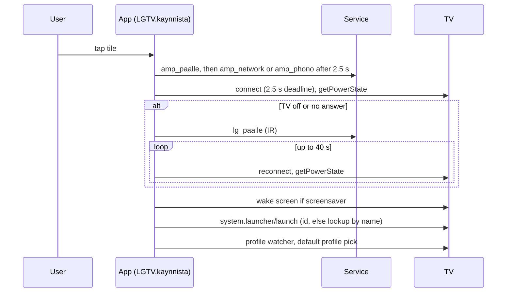

# Architecture

The stable structure of Kauko. Files and types are named, not linked. Identifiers are Finnish; see the glossary
in `docs/DEVELOPMENT.md`.

## Bird's-eye view

The problem: a phone should replace two remotes (an LG webOS TV and an IR-controlled amplifier) and should do things
neither remote does, such as typing a search into a TV app that has no text input API.

Two processes: the **iPhone app** talks to the TV directly over WebSocket; a small **Python service** turns HTTP
commands into Home Assistant calls that fire infrared codes at the amplifier (and, as a fallback, the TV). The TV
exposes no API for the focus state of third-party apps, so the app reads its screenshots. `README.md` has a diagram.

## Codemap

- `koe-avaus/Sources/Kosketuslevy.swift` holds `LGTV`, the one object that owns the TV connection: SSAP
  registration, pointer socket, foreground/power/playback state, awaited requests, screenshots, the Netflix search
  queue, the profile watcher and the seek logic, plus the touchpad view. It is the largest file (999 lines).
- `Aloitus.swift` defines the `Palvelu` enum, the cold-start chain (`kaynnista`), TV power handling, home screen.
- `RuudukkoHaku.swift` defines the `HakuRuudukko` protocol and the generic search engine. `AreenaRuudukko.swift`,
  `AreenaHaku.swift`, `YouTubeRuudukko.swift`, `YouTubeHaku.swift` are the grid models. `NetflixHaku.swift` is the
  Netflix grid model plus `Kuvapisteet`, the 960x540 pixel buffer all classifiers read.
- `YouTubeProfiili.swift` (plus profile code in `Kosketuslevy.swift`) drives "Who is watching?". `ToistoOSD.swift`
  reads playback position from the pause overlay with Vision OCR.
- `Ohjaus.swift`: control and profile views. `RemoteKoeApp.swift`: start-up, volume bridge (`AaniNapit`), settings.
- `Shared/` (`Osoitteet`, `OpenKaukoIntent`) is compiled into both the app and the `Control/` widget.
  `palvelu/kauko-palvelu.py` is the whole service; `test_kauko_palvelu.py` tests it.

## The TV connection (SSAP and the pointer socket)

SSAP is LG's JSON-over-WebSocket protocol. `LGTV.yhdistaNyt` does this, in order:

1. Open `wss://<tv>:3001`. The TV's certificate is self-signed, so the session delegate accepts a server trust only
   when the host equals the configured TV address.
2. Send `register` with a manifest (the public LG test signature) and the stored client key. The first time, the TV
   asks for approval on screen; the key it returns is stored and reused.
3. Request `getPointerInputSocket`. The reply holds the URL of a second WebSocket. Text messages on it
   (`type:move\ndx:..\ndy:..`, `type:click`, `type:scroll`, `type:button\nname:ENTER`) act as mouse and remote keys.
4. Subscribe on the main socket to the remote keyboard, foreground app, media state and power state.

Requests that need an answer get an id (`q<n>`) and a stored continuation, with a 4 s timeout; fire-and-forget
commands (`m<n>`, `ime<n>`) do not wait. One connect runs at a time; concurrent callers await it. A TV that is off
never answers, so connect has a deadline (4 s by default, shorter in callers).

## Screenshot-based focus reading

Netflix, Areena and YouTube take typed characters only from a grid on screen. The TV allows a screenshot request
(`tv/executeOneShot`, permission `CONTROL_TV_SCREEN`) that returns an image URL. `Kuvapisteet` draws that image into a
960x540 RGBA buffer, so all coordinates are in that space. A classifier per app (`NetflixRuudukko.tunnista`,
`AreenaRuudukko.tunnista`, `YouTubeRuudukko.tunnista`) samples fixed regions and returns a state: focus on key
(r, c), search tab, results view, side bar, profile screen, or "other". Thresholds are brightness, a color
difference or a count of bright pixels in a region; all were measured on captured frames and are noted in
comments. A search then works like this: *anchor* (steer into the keyboard until the image shows a key focused),
*plan* (`siirry` returns the arrow presses to the next key), *press*, and *verify* (an image 0.8 s after the last
press must show the expected key, otherwise the position is dropped).

## Cold-start chain

## Invariants

- **No confirmation, no OK.** In every grid search, ENTER is sent only when the position is known from a screenshot
  or was computed from a recent verified one. A computed position expires after 5 s.
- **Anything that moves focus clears the position.** The touchpad, a click, a scroll and every remote button set
  the cached grid positions to nil (`liiku`, `klikkaa`, `vieritä`, `nappi`), because the TV's focus follows the pointer.
- **The app never talks to the amplifier directly**, and the service never talks to the TV except through Home
  Assistant's IR. All TV control is SSAP, except the IR power-on and the IR power-off fallback.
- **The service holds no device state.** It is a command table; volume is its only read (an input_number).
- **The token never leaves the service**: it is read from a file per request and a test asserts it is absent from
  all responses and logs.
- **No machine-learning model, and no screenshot is saved.** Images exist in memory only (profile thumbnails are
  cropped from them for display).
- **Wake the screen before key presses.** `herataNaytto` calls `turnOnScreen` from Screen Off and Screen Saver,
  because those states swallow the first key.

## Boundaries

App to TV: SSAP and the pointer socket. App to service: `POST /k/<command>`, 3 s timeout. Service to Home
Assistant: REST with a bearer token, 3 s timeout. The classifiers are pure functions of a `Kuvapisteet`, separate from
the code that sends keys; only the Vision call in `ToistoOSD` is named in comments as platform-specific.

## Cross-cutting concerns

- **Errors.** The app shows everything as one status line (`tila`). A failing search clears its queue and position,
  so the next attempt re-anchors. The service answers 502 with a short reason and logs one line per request.
- **Concurrency.** `LGTV` is `@MainActor`; each search has one queue and one worker task. Pointer moves are
  coalesced (`liiku`/`tyhjenna`): deltas arriving during a send are summed into the next one.
- **Testing.** The service has integration tests with a fake Home Assistant. The app is tested end to end by
  XCUITests against the real TV; classifier thresholds are validated by those runs and by the measurements recorded
  in comments, not by unit tests.
- **Observability.** The service logs `time client method path status ha_ms`. The Control Center intent and the app
  send timestamps (`/ping?vaihe=painallus`, `vaihe=active`) so press-to-launch latency can be read from the log.
- **Security.** The service has no authentication and binds `0.0.0.0`; it assumes a trusted LAN. The app permits
  local-network HTTP only (`NSAllowsLocalNetworking`). The LG signature is public, not a secret.
- **Performance.** Key delay in a grid is 0.2 s (Netflix 0.05 s), from lost-press counts in recorded runs. The
  profile watcher polls every 1.5 s (5 s after a pick) and pauses during a search.

## Key design decisions

**1. Phone talks to the TV directly; the service handles only IR.**
Context: the amplifier is IR-only and reachable through Home Assistant, but the TV has a network API.
Decision: SSAP for everything the TV can do; the service only for IR, including the TV power fallback.
Consequences: no extra hop on the touch path (comments mark press latency as a requirement). The app needs the TV's
address and a client key, and breaks if LG changes SSAP.

**2. Verify focus with a screenshot before sending OK.**
Context: blind key sequences drifted. Recorded failures: a blind OK in Netflix results started an episode, a 0.1 s
sequence in Areena ended in a category, an Areena arrow press was lost at 0.2 s after the first letter.
Decision: press OK only on a position confirmed by, or recently verified against, a screenshot.
Consequences: reliable typing, at the cost of screenshot latency per anchor and a post-check per batch.

**3. Pixel thresholds on a fixed 960x540 frame, not a model.**
Context: the screens are drawn by the TV apps from fixed layouts, and every capture is scaled to 960x540.
Decision: sample known regions and compare brightness or color; keep every measured value next to the code.
Consequences: fast, no dependencies. Brittle to app redesigns: the Netflix focus detector was replaced when its
UI changed between 5 and 7 October 2026 (comments in `NetflixHaku.swift`).

**4. One generic grid engine, one grid model per app.**
Context: Areena and YouTube needed Netflix's queue, anchoring and verification, with different layouts.
Decision: `HakuRuudukko` describes layout, key plan and classifier; `RuudukkoHaku<M>` drives it.
Consequences: a new grid is one model file. Netflix keeps its own earlier copy of the engine in `LGTV`.

**5. Hardware volume through KVO and a hidden `MPVolumeView`.**
Context: the amplifier is volume-controlled through Home Assistant, and a volume button press reaches an app only
as a change of `outputVolume`.
Decision: observe `outputVolume`, send up or down, reset the system volume with a hidden slider (which also
suppresses the volume overlay, per comments). Consequences: works at the ends of the range, but only in the foreground.

**6. Cron plus `flock` instead of a supervisor.**
Decision: a lock file and a once-a-minute cron entry; a second instance exits with status 0 and no output.
Consequences: restart within a minute after a crash, no init-system config; no graceful hand-over.
