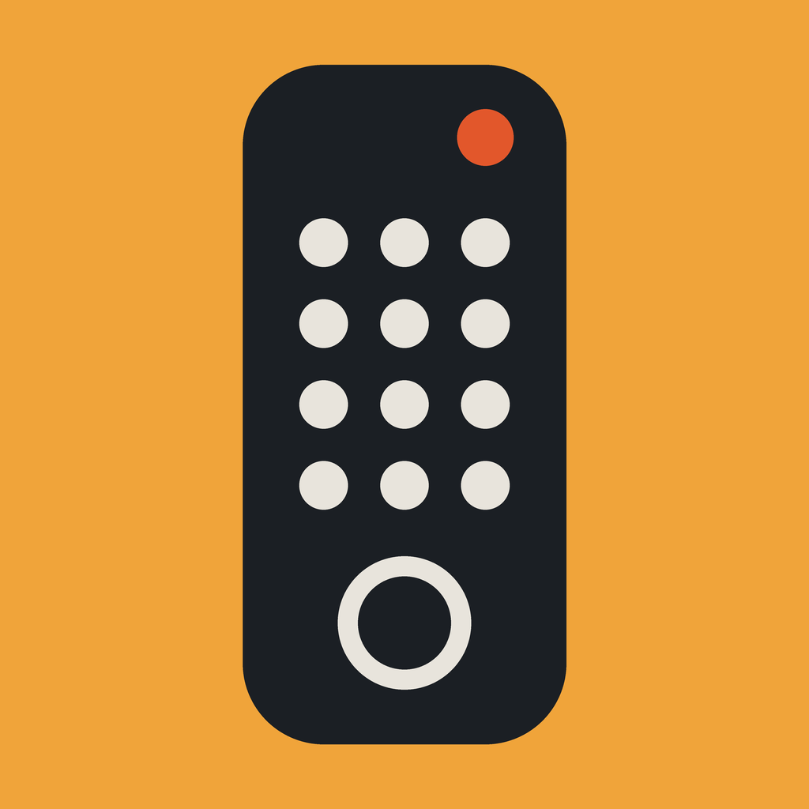
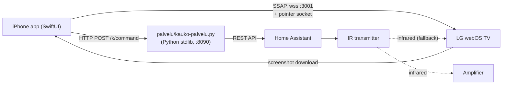

# Kauko



An iPhone remote for an LG webOS TV and for an amplifier that is controlled over infrared through Home Assistant.

I built it for my own living room (an LG C1 and a Marantz amplifier). One tap on a service tile starts the amplifier,
selects its input, wakes the TV and launches the app. After that the phone is a touchpad and a keyboard, and for apps
that do not open the TV's own keyboard it types into their on-screen letter grid by reading the TV's screenshots.
*Kauko* is Finnish for "remote" (short for *kaukosäädin*).

## What it does

- **One-tap start.** Tiles for Netflix, Yle Areena, YouTube, Prime Video, Live TV and Phono (the turntable input).
  A tile starts the amplifier, selects its input, powers on the TV if needed (infrared fallback) and launches the app.
- **Touchpad.** The phone drives the TV's pointer directly: drag to move, tap to click, a side strip to scroll.
- **Keyboard.** Typing on the phone reaches the TV's text fields through webOS's remote-keyboard service.
- **Search in apps without a TV keyboard.** Netflix, Areena and YouTube search is typed into their letter grids with
  arrow keys, one confirmed focus position at a time.
- **Profile picker.** The "Who is watching?" screen of Netflix and YouTube is shown on the phone; tap a profile,
  or long-press to make it the default that is picked automatically after a cold start.
- **Seek bar.** In landscape, a slider seeks inside an Areena or Netflix episode by stepping the TV's own preview.
- **Hardware volume buttons** control the amplifier while the app is open.
- **Control Center button** (iOS 18 control widget) opens the app from the lock screen.

## Visual



## Engineering highlights

- **Computer vision without ML.** Netflix, Areena and YouTube do not expose their on-screen keyboards, so the app
  decides where the focus is by thresholding pixels in a 960x540 screenshot of the TV. The key press OK is sent only
  after the image confirms the focus position. A blind OK once started an episode instead of typing a letter.
  See [NetflixHaku.swift](koe-avaus/Sources/NetflixHaku.swift),
  [AreenaRuudukko.swift](koe-avaus/Sources/AreenaRuudukko.swift),
  [YouTubeRuudukko.swift](koe-avaus/Sources/YouTubeRuudukko.swift).
- **Grid path planning.** Each grid model (`siirry`, `painallukset`) turns text into the shortest sequence of arrow
  presses, including the quirks of wide keys and of focus returning to a different column.
- **One protocol for three grids.** `HakuRuudukko` describes a grid; `RuudukkoHaku` is the shared engine. It diffs the
  text field against the previous value, queues only the changes, and one task drains the queue. A computed position
  is trusted for 5 s and is discarded whenever the touchpad or a button moves focus.
  See [RuudukkoHaku.swift](koe-avaus/Sources/RuudukkoHaku.swift).
- **Seeking by reading the TV's overlay.** The slider pauses playback, reads the elapsed and total time from the
  on-screen overlay with Apple's Vision text recognition, steps the preview in 10 s increments while you drag, checks
  the result against the image after release and then resumes. See
  [ToistoOSD.swift](koe-avaus/Sources/ToistoOSD.swift).
- **Pointer move coalescing.** While one move message is in flight, new finger movement accumulates and is sent as one
  message when the send completes, so the TV never receives a backlog. See `liiku` and `tyhjenna` in
  [Kosketuslevy.swift](koe-avaus/Sources/Kosketuslevy.swift) (lines 899-924).
- **Hardware volume buttons repurposed.** A key-value-observation of `outputVolume` detects a button press, sends
  up or down to the amplifier and resets the system volume through a hidden `MPVolumeView` slider, so the buttons keep
  working at the ends of the range. See [RemoteKoeApp.swift](koe-avaus/Sources/RemoteKoeApp.swift).
- **Cold-start chain.** Starting an app from a powered-off setup is a sequence of IR commands, power-state polling
  (up to 40 s; the TV measured 26-29 s), a wake-up of the screensaver, an app launch by id with a lookup-by-name
  fallback, and an automatic profile pick. See [Aloitus.swift](koe-avaus/Sources/Aloitus.swift).
- **Small, tested service.** [kauko-palvelu.py](palvelu/kauko-palvelu.py) is Python standard library only. It
  uses `flock` so cron can start it every minute and extra instances exit silently, has a `--check` preflight, and
  has 12 integration tests against a fake Home Assistant ([test_kauko_palvelu.py](palvelu/test_kauko_palvelu.py)),
  including one that asserts the access token never appears in responses or logs.

## Tech stack

| Layer | Technology | Version |
|---|---|---|
| iOS app | Swift, SwiftUI; Vision, ImageIO, AVFoundation, MediaPlayer, WidgetKit, AppIntents | deployment target iOS 18.0 |
| Project generation | XcodeGen (`koe-avaus/project.yml`) | built here with 2.46.0 |
| IDE / toolchain | Xcode | built here with 27.1 (Swift 6.4) |
| TV protocol | LG webOS SSAP over WebSocket (`wss`, port 3001) plus the pointer input socket | LG C1 only |
| Service | Python 3, standard library only | tests run here on 3.15.0 |
| Home automation | Home Assistant REST API (`button.press`, `script.turn_on`, `input_number.set_value`) | version not recorded |

## Architecture

The app talks to the TV directly: it registers over SSAP, asks the TV for a second WebSocket (the pointer input
socket) for touch and key events, and subscribes to foreground app, power state, playback state and the remote
keyboard. It only talks to the service for what the TV cannot do, which is the amplifier and IR power commands. The
service is a thin command list that turns `POST /k/<command>` into Home Assistant service calls. Focus in apps with
on-screen grids is never assumed: the app asks the TV for a screenshot and classifies it. See
[ARCHITECTURE.md](ARCHITECTURE.md) for the connection setup, the invariants and the design decisions.

## Repository layout

```
koe-avaus/            iOS app (Finnish for "trial opening"; the Xcode project is named RemoteKoe)
  Sources/            app: SSAP client (Kosketuslevy.swift), grid search, OSD reading, UI
  Shared/             code shared by the app and the Control Center widget (address settings, App Intent)
  Control/            Control Center widget extension
  UITests/            8 XCUITests that run against the real TV
  Config/             build settings; Local.xcconfig (gitignored) holds your team id
  Resources/          app icon, third-party service logos
  project.yml         XcodeGen project definition
palvelu/              Python command service + tests
docs/DEVELOPMENT.md   how the project was developed, plus a glossary of the Finnish terms
```

**Naming.** The same project has several names for historical reasons: *Kauko* (this README and the pairing prompt),
*Controller* (the name on the home screen), *RemoteKoe* (Xcode project and scheme), `koe-avaus` (the directory) and
`remote` (the repository and bundle id suffix). I did not rename anything. Identifiers and comments are in Finnish;
[docs/DEVELOPMENT.md](docs/DEVELOPMENT.md) has a glossary.

## Getting started

Prerequisites: a Mac with Xcode, [XcodeGen](https://github.com/yonaskolb/XcodeGen) (`brew install xcodegen`), an
iPhone on iOS 18 or later, an LG webOS TV on the same network, and, for the amplifier, a Home Assistant instance with
IR buttons. The app builds without the service and the amplifier, but then only the TV functions work.

1. Copy `koe-avaus/Config/Local.xcconfig.example` to `koe-avaus/Config/Local.xcconfig` and set your own Apple team id
   (`DEVELOPMENT_TEAM`) and a bundle id prefix (`BUNDLE_ID_PREFIX`, for example `com.yourname`). The file is gitignored.
2. Generate the project and build:

       cd koe-avaus
       xcodegen generate
       open RemoteKoe.xcodeproj

   Select your iPhone and run (Cmd-R). From the command line:
   `xcodebuild -project RemoteKoe.xcodeproj -scheme RemoteKoe -destination 'generic/platform=iOS' build`.
   (I checked that this build succeeds with `CODE_SIGNING_ALLOWED=NO`; running on a device needs signing.)
3. On first launch the app opens its settings. Enter the service address (for example `palvelin.local:8090`; port
   8090 if omitted) and the TV's address or name. They are stored on the device and can be changed from the gear icon.

**Pairing with the TV.** The app uses LG's public test signature (see `manifestSignature` in
[Kosketuslevy.swift](koe-avaus/Sources/Kosketuslevy.swift)), the same one used by libraries such as bscpylgtv. It is
not a secret. On the first connection the TV asks on screen whether to allow the device "Kauko"; accept it with the
TV's own remote. The key the TV returns is stored in the app. Phone and TV must be on the same network.

**The service.**

    python3 palvelu/kauko-palvelu.py --check   # preflight: address, token, Home Assistant, port
    python3 palvelu/kauko-palvelu.py           # serve on port 8090

| Variable | Default | Purpose |
|---|---|---|
| `HA_URL` | none | Home Assistant address, for example `http://homeassistant.local:8123` |
| `HA_URL_FILE` | `~/.config/ha/url` | address from a file when `HA_URL` is not set |
| `HA_TOKEN_FILE` | `~/.config/ha/token` | Home Assistant long-lived access token |
| `KAUKO_PORT` | `8090` | listening port |
| `KAUKO_LOCK` | `~/.local/state/kauko-palvelu.lock` | lock file: one instance at a time |

Because of the lock, cron can start the service every minute; an extra start exits at once. Example
`/etc/cron.d/kauko` line (replace `<USER>` and `<PATH>`):

    * * * * * <USER> HA_URL=http://homeassistant.local:8123 python3 <PATH>/palvelu/kauko-palvelu.py >> /tmp/kauko-palvelu.log 2>&1

The service expects these Home Assistant entities: `button.ir_kaukosaadin_<command>` for `amp_paalle`, `amp_pois`,
`amp_optical`, `amp_phono`, `amp_mykistys`, `lg_paalle` and `lg_pois`; `script.marantz_lahde_network` (command
`amp_network`); and `input_number.marantz_nupin_kohde` with `script.marantz_nuppiajuri` for volume (capped at 45).
Endpoints: `GET /ping`, `GET /komennot`, `POST /k/<command>`.

## Tests

- **Service:** 12 integration tests start the real service as a subprocess against a fake Home Assistant on a random
  port. They cover button and script calls, the volume ceiling and floor, unknown routes, a Home Assistant failure
  (502), a second instance exiting silently, HTTP keep-alive, a reset connection leaving no traceback, and token
  leakage. Run: `cd palvelu && python3 -m unittest test_kauko_palvelu` (about 1.5 s; all passed when I ran them).
- **App:** 8 XCUITests in `koe-avaus/UITests` (Netflix, Areena and YouTube search; Netflix and YouTube profile tap;
  Areena search typed at human pace; YouTube digits; Prime launch). They run in the iOS simulator against the real service and the
  real TV, so they cannot run without that hardware:

      cd koe-avaus
      TEST_RUNNER_KAUKO_PALVELU=<address> TEST_RUNNER_KAUKO_TV=<address> \
        xcodebuild -project RemoteKoe.xcodeproj -scheme RemoteKoe -destination '<simulator>' test

  I did not run these for this documentation. There is no CI and no unit test target for the pixel classifiers.
  Several tests also expect a Mac-side helper that photographs the TV during the run (see the test comments); that
  helper is not in this repository.

## How it was built

I (Mikko Paaso) set the requirements, designed the architecture and directed the work. Claude Code agents wrote the
code from written task briefs, and tests and runs on the real TV and phone were the acceptance gates. I reviewed the
results and decided what to keep. What this repository shows of that process:

- 34 commits between 2026-10-05 and 2026-10-28 (31 of them on 5-7 October), all with a `Co-Authored-By: Claude`
  trailer, and 20 distinct task identifiers (`REMOTE-NETFLIX-HAKU`, `REMOTE-VAAKA`, ...) in the commit subjects.
- Code comments record the measurements behind each constant: dates, what failed, and how many presses were lost at
  which delay (for example 64/64 correct at 0.15-0.2 s, lost presses at 0.1 s, in `RuudukkoHaku.swift`).
- The briefs and the Finnish working registers lived in my private monorepo and are not part of this repository.

More in [docs/DEVELOPMENT.md](docs/DEVELOPMENT.md).

## Status and limitations

- A working personal project, extracted from a private monorepo. Some comments mention helper scripts and image
  folders from that repository (for example `simajo.sh`, `ytaja.sh`) that are not included.
- Tested only against one LG C1 and one amplifier. The pixel thresholds were measured on those apps' screens in
  October 2026; an app UI update can break the classifiers. This has already happened once with Netflix.
- Netflix search has its own copy of the queue logic in `Kosketuslevy.swift` instead of using the shared
  `RuudukkoHaku` engine used by Areena and YouTube.
- The service listens on `0.0.0.0:8090` **without authentication** and is meant for a trusted home LAN only. Do not
  expose it to the internet.
- The Home Assistant side (entities, scripts, IR codes) is not included; you need to create it yourself.
- UI texts and code identifiers are Finnish. No Android client exists, although some comments note that the logic is
  portable.
- The `kuvake-*.png` files in `koe-avaus/Resources` are third-party service logos (Netflix, Yle Areena, Prime Video,
  YouTube) and are not covered by this license.
- The 8 UI tests need real hardware; there is no CI.

## License

AGPL-3.0-only, see [LICENSE](LICENSE). Copyright (c) 2026 Mikko Paaso. The third-party logos mentioned above are excluded.
